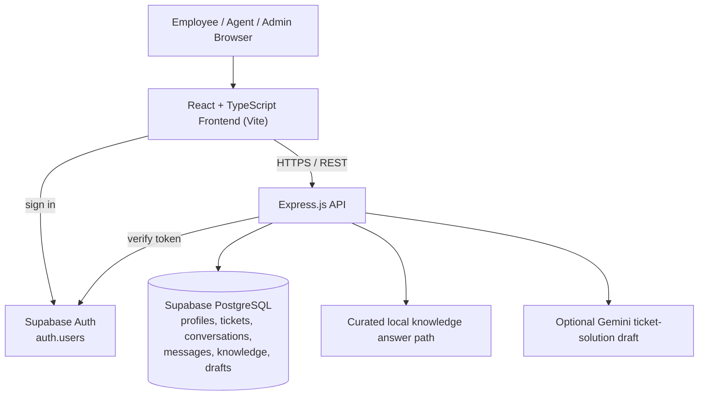

# Harbor Tickets

> **Course:** Applied Generative AI for IT Solution Development
> **Project Title:** Harbor Tickets
> **Team:** Harbor · **Members:** Sta. Ana, Matthew E. · Rullan, Harvey · Saluta, James · Reganit, John

---

## 1. Project Overview

Harbor Tickets is a web-based IT helpdesk prototype that helps employees get answers to routine IT questions, manage conversations, submit support tickets, and request human assistance. Employees, agents, and administrators use role-specific workflows. Agents can manage assigned tickets, reply in linked conversations, draft ticket solutions, and submit knowledge pairs for review. Administrators manage users, ticket assignment, the knowledge base, and operational views.

The target users are employees requesting IT help, IT support agents handling the queue, and administrators overseeing access and service metrics. Harbor Tickets uses fictional users, tickets, and procedures. It is not connected to a real organization's identity directory or production IT infrastructure. Chat answers use the curated local knowledge set; Gemini is used server-side for optional ticket-solution drafts.

---

## 2. Problem Statement

Employees often ask repeated questions about account access, VPN connectivity, software installation, and other routine IT issues. When answers are scattered across documents or depend on an agent's availability, employees may wait longer, support staff repeatedly answer the same questions, and requests may be documented or routed inconsistently.

AI is appropriate because a language model can interpret natural-language requests, while RAG can provide approved support documentation as context. The backend must still validate requests, enforce permissions, record outcomes, and escalate sensitive or uncertain cases. AI-generated text alone does not authorize or execute privileged operations.

---

## 3. Objectives

**General objective:** Develop a web-based helpdesk prototype that provides grounded IT support answers, manages support tickets, and demonstrates safe workflow automation and human escalation.

**Specific objectives:**

1. Build a responsive React interface for employee chat and role-appropriate agent and administrator workflows.
2. Develop an Express REST API for authentication-aware chat, tickets, knowledge retrieval, and operational data, using Supabase for persistence.
3. Rank curated fictional IT procedures and return grounded answers with source references, or express uncertainty and offer ticket creation.
4. Implement backend-validated, allowlisted ticket and escalation actions, with authorization checks and audit records.
5. Evaluate the prototype with automated functional, integration, security, RAG, and resilience tests, and document limitations.

---

## 4. Scope & Limitations

**Included:**

- Employee sign-in, self-registration, profile settings, and conversational support through Harbor.
- Fictional, curated IT support knowledge articles and retrieval/source-reference behavior.
- Ticket creation, requester views, agent assignment/status workflows, linked replies, and human escalation.
- Role-based employee, agent, and administrator access, with Supabase Auth, application profiles, and database RLS policies.
- Conversation rename, archive, restore, and deletion controls for employees.
- Agent ticket-solution drafts with optional Gemini generation, plus a review queue for agent-submitted knowledge pairs.
- Admin user management, account suspension/bans, ticket queue, knowledge base, and role-scoped metrics.
- Admin knowledge base showing all articles (seeded + accepted agent submissions) with a New pair form.
- Admin queue with Tickets and Solutions subtabs (combined from previous separate KB Queue page).
- Automated client and server tests, plus configured browser end-to-end tests.

**Excluded or limited:**

- Real corporate identity-directory, ServiceNow, or Jira integration unless separately approved and configured.
- Real password resets, account provisioning, or software installation. These are not autonomous actions in this prototype.
- Guaranteed resolution of every request, production-grade uptime, enterprise load certification, or formal security/compliance certification.
- Real employee personal data or secrets in prompts, logs, or demo data. Demo content is fictional.

---

## 5. Technologies

| Component      | Technology                           | Notes                                                                                                   |
| :------------- | :----------------------------------- | :------------------------------------------------------------------------------------------------------ |
| Frontend       | React + TypeScript + Vite            | Chat, ticket, knowledge base, and admin dashboard views.                                                |
| Backend        | Node.js + Express.js + TypeScript    | REST API, validation, authorization, ticket and conversation workflows, and knowledge access.           |
| Database       | Supabase PostgreSQL                  | Profiles, tickets, conversations, messages, knowledge, audit records, submissions, and solution drafts. |
| Authentication | Supabase Auth                        | Manages `auth.users`; application roles in `profiles` table.                                            |
| Knowledge      | Curated local knowledge set          | Current chat-answer path returns grounded answers and source references without hosted-model calls.     |
| LLM            | Google Gemini API                    | Optional server-side ticket-solution drafting; key in `GEMINI_API_KEY`.                                 |
| Embeddings     | pgvector / Gemini configuration      | Available for ingestion configuration; not used by the current chat-answer path.                        |
| Deployment     | Vercel (frontend) + Render (backend) | Repository configuration is present; hosted services and domains are not verified here.                 |

---

## 6. System Architecture



The frontend authenticates with Supabase Auth and sends its token to the Express API. The API resolves role and account status from `profiles`, enforces authorization, and persists ticket and conversation workflows in Supabase. Chat answers use the curated local knowledge set; Gemini is called server-side only for optional agent ticket-solution drafts.

**Security:** `GEMINI_API_KEY` and service-role credentials stay in server environment variables only, never in the browser.

For the full architecture document with sequence diagrams, see [docs/deliverables/required/06-system-architecture.md](docs/deliverables/required/06-system-architecture.md).

---

## 7. Database Design

Core tables: `auth.users` (Supabase), `profiles`, `tickets`, `ticket_solution_drafts`, `conversations`, `messages`, `knowledge_articles`, `knowledge_chunks`, `audit_logs`, `automation_runs`, and `kb_submissions`.

`kb_submissions` holds agent-submitted problem → solution pairs that go through an admin accept/deny queue before appearing in the knowledge base. The `knowledge_articles` table holds seeded IT procedures; the Knowledge Base admin page shows both.

For the full ERD and RLS policy table, see [docs/deliverables/required/07-database-design.md](docs/deliverables/required/07-database-design.md).

---

## 8. UI Overview

### Employee (`/`, `/chat`, `/archive`, `/settings`, `/tickets`)

- **Chat** — conversational IT support via Harbor. Answers cite knowledge sources; uncertain responses offer ticket creation.
- **Archive** — review, restore, and manage archived conversations.
- **Settings** — edit the user's display name.
- **My Tickets** — view submitted tickets; track status.

### Agent (`/chat`, `/tickets`, `/dashboard`)

- **Chat** — view authorized conversations; reply to employees and submit (problem, solution) pairs to the admin review queue.
- **My Tickets** — list tickets assigned to the agent; change status; link to open the linked chat conversation.
- **Dashboard** — role-scoped operational metrics.

### Admin (`/queue`, `/admin/users`, `/admin/kb-articles`, `/dashboard`)

- **Queue** — two subtabs:
  - **Tickets** — full ticket list with status/assignee filters; ticket detail in split panel.
  - **Solutions** — pending agent KB submissions; accept or deny each with optional note.
- **Knowledge Base** — all KB articles (seeded + accepted submissions); create new pairs directly (auto-accepted).
- **Users** — create staff accounts, manage roles, suspend/unsuspend accounts, and ban accounts.
- **Dashboard** — system-wide metrics.

For low-fidelity wireframes, see [docs/deliverables/wireframes/agent-admin.md](docs/deliverables/wireframes/agent-admin.md).

---

## 9. AI Prompt Design

The prompt taxonomy below documents the project's planned/guarded AI contracts; it does not mean Gemini answers employee chat. Current chat uses curated local knowledge, while Gemini is optional for agent ticket-solution drafts.

Three prompt types:

| ID    | Purpose                   | Output                                                  |
| :---- | :------------------------ | :------------------------------------------------------ |
| AI-P1 | Grounded knowledge answer | Answer + source refs, or uncertainty + escalation offer |
| AI-P2 | Intent / action proposal  | Structured JSON intent; backend validates and executes  |
| AI-P3 | Escalation summary        | Human-readable summary for the assigned agent           |

Agents can also trigger an on-demand **Gemini ticket solution draft** from the chat reply panel; this uses the ticket description and category as context.

For full prompt text and contracts, see [docs/deliverables/required/09-ai-prompt-design.md](docs/deliverables/required/09-ai-prompt-design.md) and [docs/deliverables/required/08-prompt-taxonomy.md](docs/deliverables/required/08-prompt-taxonomy.md).

---

## 10. Workflow Automation

The backend enforces an allowlist. Supported actions: `create_ticket`, `escalate_to_human`, `request_clarification`, `send_test_notification`. Any action not on the allowlist is rejected; the model cannot confirm execution or grant permissions.

For the full flow diagram and guardrails, see [docs/deliverables/required/10-workflow-automation.md](docs/deliverables/required/10-workflow-automation.md).

---

## 11. Timeline

Five sprints from October–December 2026. For the sprint breakdown, see [docs/deliverables/required/11-timeline.md](docs/deliverables/required/11-timeline.md) and the sprint folders under [docs/sprints/](docs/sprints/).

---

## 12. Team Harbor

Team name: **Harbor**.

| Member               | Role                                 |
| :------------------- | :----------------------------------- |
| Sta. Ana, Matthew E. | Lead developer, architecture, DevOps |
| Rullan, Harvey       | Backend / API hardening              |
| Saluta, James        | Frontend / accessibility             |
| Reganit, John        | QA / RAG evaluation                  |

---

## 13. Testing

The latest published full-suite evidence is from **November 20, 2026** and predates the changes in this worktree. It is historical evidence, not a verification claim for the current diff; run `npm run verify:all` for the current state.

| Test area                  | Result            | Notes                                                              |
| :------------------------- | :---------------- | :----------------------------------------------------------------- |
| Client typecheck           | Pass              | TypeScript project build passed.                                   |
| Server typecheck           | Pass              | TypeScript no-emit check passed.                                   |
| Client automated tests     | Pass              | 44 tests across 4 files.                                           |
| Server automated tests     | Pass              | 109 tests across 17 files.                                         |
| Lint + formatting          | Pass              | Both workspaces passed.                                            |
| Client production build    | Pass with warning | 528 KB chunk-size warning remains.                                 |
| Performance / resilience   | Pass              | 2 focused tests including bounded timeout behavior.                |
| Playwright E2E             | Not run           | Requires `E2E_BASE_URL`, `E2E_API_URL`, and seeded infrastructure. |
| Hosted Gemini measurements | Not run           | Live model latency and quota were not measured.                    |

See [docs/sprints/sprint-5/final-qa-report.md](docs/sprints/sprint-5/final-qa-report.md) for full evidence and caveats.

---

## 14. Final Deliverables

- **Working System:** This repository. Local setup and demo walkthrough in this README and [docs/resources/john-demo-walkthrough.md](docs/resources/john-demo-walkthrough.md).
- **Source Code:** `client/`, `server/`, `supabase/`, `tests/`.
- **Slides:** Outline at [docs/resources/matthew-defense-deck.md](docs/resources/matthew-defense-deck.md).
- **Supporting evidence:** Sprint evidence, QA reports, API specs, wireframes, and testing matrix in `docs/`.

---

## Local Setup

Requires **Node 22+** and **Docker**. The Supabase CLI is installed as a dev dependency.

```bash
npm install
npm run env:create            # creates client/.env and server/.env from examples
npm run supabase:start        # prints local API URL, anon key, service_role key
npm run supabase:reset:local  # applies migrations without seed.sql
npm run supabase:seed:local   # seeds the local database without resetting
```

Copy the values from `supabase:start` into the env files:

- `server/.env` → `SUPABASE_URL`, `SUPABASE_SERVICE_ROLE_KEY`, `GEMINI_API_KEY`
- `client/.env` → `VITE_SUPABASE_URL`, `VITE_SUPABASE_ANON_KEY`, `VITE_API_URL=http://localhost:3001`

Then run `npm run dev` and open <http://localhost:5173>.

### Demo accounts (fictional, local only — password `Password123!`)

| Email                    | Role     | Lands on          |
| :----------------------- | :------- | :---------------- |
| `dana.cruz@example.test` | employee | Chat              |
| `lee.agent@example.test` | agent    | My Tickets        |
| `ari.admin@example.test` | admin    | Queue (Dashboard) |

Roles come from `public.profiles`, never from user-editable auth metadata.
Additional fixture accounts populate ticket/chat history and admin status views: Elena, Omar, and Jo are active; Priya is suspended and Noah is banned. All use the same local-only demo password.

To work with the **hosted** project instead, run `npm run supabase:login` once, then `npm run supabase:link`. See [docs/deliverables/development-workflow.md](docs/deliverables/development-workflow.md) for every script.

### Tests

```bash
npm run verify:all       # typecheck, unit + integration tests, lint, format, build
npm run test:performance # bounded timeout and resilience checks
npm run test:e2e         # Playwright; requires E2E_BASE_URL to be set
```

E2E against local stack:

```bash
npx playwright install chromium
E2E_BASE_URL=http://localhost:5173 E2E_API_URL=http://localhost:3001 npm run test:e2e
```

### Assets

Static images (`logo.png`, `logo-harbor.png`) are in `client/public/assets/` and served at `/assets/logo.png` and `/assets/logo-harbor.png`.

---

## Documentation Index

| #   | Document                                                                          | Description                                 |
| :-- | :-------------------------------------------------------------------------------- | :------------------------------------------ |
| 1   | [Project Overview](docs/deliverables/required/01-project-overview.md)             | Harbor Tickets, target users, and intent    |
| 2   | [Problem Statement](docs/deliverables/required/02-problem-statement.md)           | The problem and why AI is appropriate       |
| 3   | [Objectives](docs/deliverables/required/03-objectives.md)                         | General and specific objectives             |
| 4   | [Scope & Limitations](docs/deliverables/required/04-scope-and-limitations.md)     | Included and excluded features              |
| 5   | [Technologies](docs/deliverables/required/05-technologies.md)                     | Stack details and deployment caveats        |
| 6   | [System Architecture](docs/deliverables/required/06-system-architecture.md)       | Architecture and request-flow diagrams      |
| 7   | [Database Design](docs/deliverables/required/07-database-design.md)               | ERD and entity tables                       |
| 8   | [AI Prompt Taxonomy](docs/deliverables/required/08-prompt-taxonomy.md)            | Prompt IDs, contracts, injection handling   |
| 9   | [AI Prompt Design](docs/deliverables/required/09-ai-prompt-design.md)             | Draft prompts and expected outputs          |
| 10  | [Workflow Automation](docs/deliverables/required/10-workflow-automation.md)       | Automation flow and guardrails              |
| 11  | [Timeline](docs/deliverables/required/11-timeline.md)                             | Sprint-based schedule                       |
| 12  | [Team Roles](docs/deliverables/required/12-team-roles.md)                         | Member roles and responsibilities           |
|     | [API Specifications](docs/deliverables/api-specifications/README.md)              | REST endpoint contracts                     |
|     | [Gemini API Configuration](docs/deliverables/gemini-configuration.md)             | Optional server-side ticket-solution drafts |
|     | [Wireframes — Employee Chat](docs/deliverables/wireframes/employee-chat.md)       | Employee chat UI wireframes                 |
|     | [Wireframes — Employee Tickets](docs/deliverables/wireframes/employee-tickets.md) | Employee ticket UI wireframes               |
|     | [Wireframes — Agent & Admin](docs/deliverables/wireframes/agent-admin.md)         | Agent chat, ticket detail, admin pages      |
|     | [Sprint 3 API Contracts](docs/sprints/sprint-3/api-contracts.md)                  | Detailed API contracts and error codes      |
|     | [Final QA Report](docs/sprints/sprint-5/final-qa-report.md)                       | Test results and AI evaluation report       |
|     | [Demo Walkthrough](docs/resources/john-demo-walkthrough.md)                       | Step-by-step demo script                    |
|     | [Defense Deck Outline](docs/resources/matthew-defense-deck.md)                    | Presentation outline                        |
