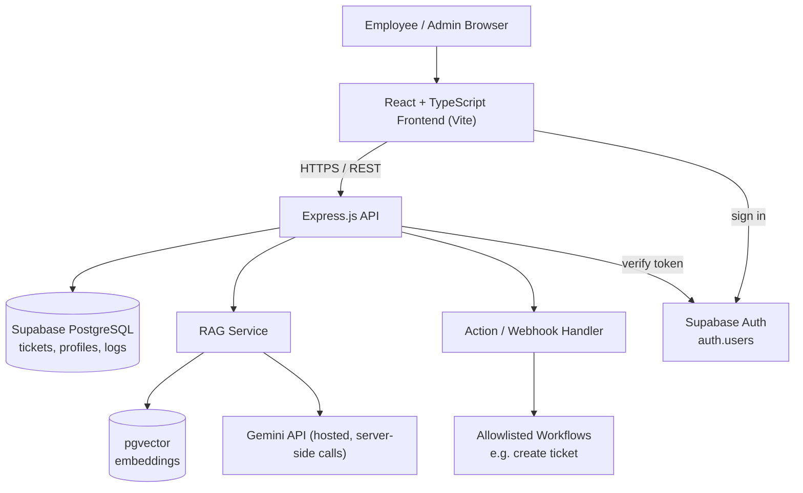
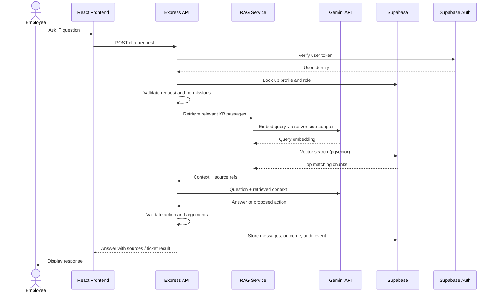

# 6. System Architecture

## High-Level Architecture

## Request Sequence

## Description

The frontend sends a question to the Express API. The API verifies the user's Supabase Auth token, looks up their profile and role, validates the request and permissions, and uses the provider adapter in `server/src/shared/ai/` for Gemini query embeddings and answer generation. The RAG service retrieves relevant knowledge-base passages and sends the question and retrieved context to the hosted Gemini API. If the model proposes a supported action, the backend validates the action and arguments before executing it. The result, response, and relevant audit event are returned or stored. Unsupported or uncertain requests receive a safe response or are escalated.

## Security Boundary

`GEMINI_API_KEY` and privileged credentials remain in server environment variables only, are never sent to the browser, and are never included in client environment variables. The LLM does not receive direct database credentials or unrestricted access to external systems.

---

[← Technologies](05-technologies.md) · [README](../README.md) · Next: [Database Design](07-database-design.md)
