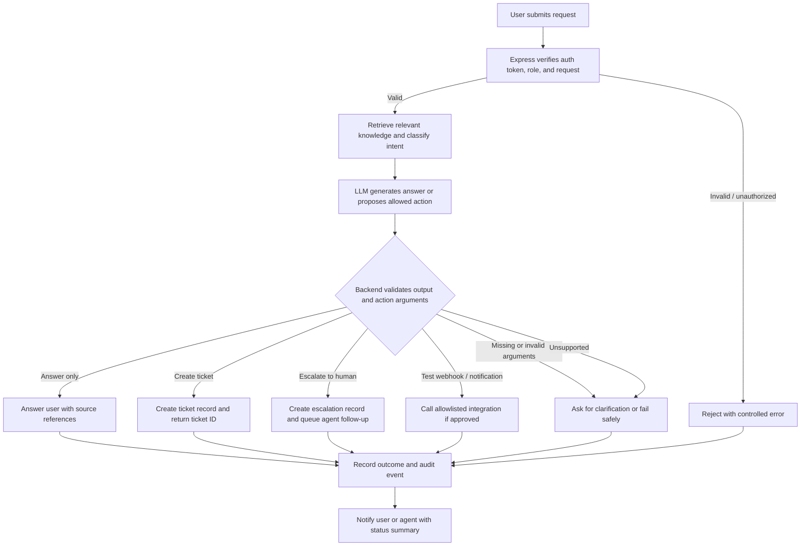

# 10. Workflow Automation

## Control objectives

- The LLM may propose a next step, but the backend remains the sole authority for validation and execution.
- Only explicitly allowlisted actions may be triggered from chat or automation outcomes.
- Missing or invalid arguments must result in a clarifying response or a safe failure, never a false success.
- Escalation to a human agent is the default path when confidence is low, a ticket is outside the approved workflow, or the user explicitly requests an agent.

## Main Workflow

## Allowlisted actions and validation

The backend uses a strict allowlist. The model may propose these actions only when they match the approved workflow and user authorization:

| Action name | Typical trigger | Required arguments | Backend validation | Result |
| :---------- | :-------------- | :----------------- | :----------------- | :----- |
| `create_ticket` | Employee reports a ticketable issue or asks for a helpdesk case | `user_id`, `category`, `summary`, `priority`, `description` | User is authenticated; required fields are non-empty; category and priority are known values; backend creates the ticket record | Return `ticket_id`, status, and summary; do not claim success before persistence |
| `escalate_to_human` | User asks for an agent, or the model is uncertain / low confidence | `user_id`, `reason`, `conversation_id`, `summary` | User is authorized; escalation reason is recognized; summary is populated; backend creates escalation record | Return escalation metadata and queue outcome |
| `request_clarification` | Missing required data or ambiguous request | `field_names`, `question`, `conversation_id` | No privileged action; backend asks for missing input and keeps the original request pending | Return a clarifying prompt and keep state unchanged |
| `send_test_notification` | Approved test workflow or internal demo integration | `channel`, `message`, `ticket_id` or `conversation_id` | Action is allowlisted, environment is approved for demo testing, and authentication is verified | Sends a simulated notification only; failure is logged and surfaced to the user |

The backend must reject any action not listed above. If a model proposes an unsupported or privileged action, the system reports a safe fallback and escalates if needed.

## Escalation workflow

1. The user asks a question, reports an issue, or requests human help.
2. The RAG service retrieves relevant knowledge and the model proposes a response or action.
3. The backend checks authorization, required fields, and the action allowlist.
4. If the issue is resolved by approved documentation, the system returns a grounded answer with citations.
5. If confidence is low, the request is missing required details, or the user requests a human agent, the system creates an escalation record.
6. The escalation payload includes the user message summary, troubleshooting context, known source references, and the reason for transfer.
7. An agent can continue from the saved conversation summary without re-asking the employee for basic details.

## Safe failure and duplicate handling

- Missing or invalid arguments cause a clarifying response, not a successful action result.
- Duplicate notification or retry requests are deduplicated by action ID or ticket ID when the backend can identify them.
- Failed integrations are logged with a structured error, and the user is told the action could not be completed without claiming it succeeded.
- Privileged operations such as provisioning, password resets, or external system changes remain out of scope unless an explicit safe test integration is approved.

## API contract note

The detailed request and response contract for the allowlisted actions is recorded in [API specifications](resources/api-specifications/allowlisted-actions.md). That specification is intentionally documentation-only for Sprint 1 and does not create executable integration handlers.

---

[← AI Prompt Design](09-ai-prompt-design.md) · [README](../README.md) · Next: [Timeline](11-timeline.md)
