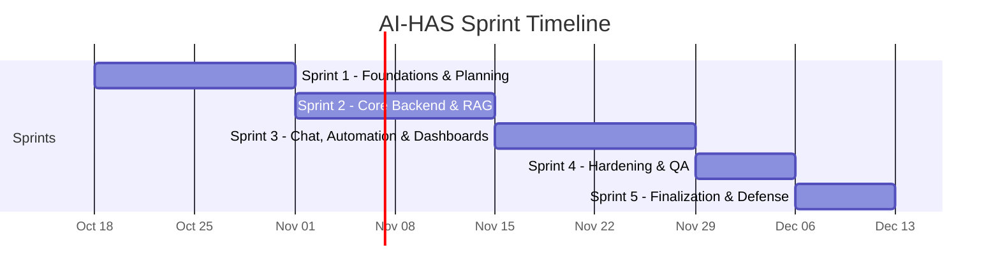

# 11. Timeline

> **Status:** Broad draft. Sprint 1 begins Sunday, October 18, 2026. Calendar ranges below use consecutive seven-day weeks; Sprint 1 task owners and acceptance criteria are tracked in the [Sprint 1 task plan](sprints/sprint-1/tasks.md).

## Sprint Overview

| Sprint                                             | Weeks | Date range         | Milestone                     |
| :------------------------------------------------- | :---- | :----------------- | :---------------------------- |
| [Sprint 1](#sprint-1--foundations--planning)       | 1–2   | Oct 18–31, 2026    | Foundations & Planning        |
| [Sprint 2](#sprint-2--core-backend--rag)           | 3–4   | Nov 1–14, 2026     | Core Backend & RAG            |
| [Sprint 3](#sprint-3--chat-automation--dashboards) | 5–6   | Nov 15–28, 2026    | Chat, Automation & Dashboards |
| [Sprint 4](#sprint-4--hardening--qa)               | 7     | Nov 29–Dec 5, 2026 | Hardening & QA                |
| [Sprint 5](#sprint-5--finalization--defense)       | 8     | Dec 6–12, 2026     | Finalization & Defense        |

---

## Sprint 1 — Foundations & Planning

### Weeks 1–2: October 18–31, 2026

Complete the following in date order. Work may overlap where dependencies allow; the dated task owners, evidence, and acceptance criteria are in the [Sprint 1 task plan](sprints/sprint-1/tasks.md).

### Week 1: October 18–24

- Kick off by confirming user journeys, prototype boundaries, required demo scope, team roles, and unresolved decisions. Record owners and due dates for decisions that cannot be closed at kickoff.
- Confirm repository layout, package manager, branch/PR workflow, environment-file policy, and GitHub repository settings. Draft the PR template and CI workflow under `.github/`; define formatting, lint, typecheck, and test checks. Prepare a GitHub ruleset/branch-protection configuration and required-check list, to be enforced after the CI checks exist and pass.
- Set up root and app-level `package.json` scripts and matching VS Code tasks. Include install-all, create-env, start-all, start-client/server, format-fix/check, lint-fix/check, frontend/backend test-watch, verify all, and Supabase link/push/reset/seed commands. Document prerequisites and ensure workspace tasks call the package scripts instead of duplicating command logic.
- Record the planned React/Vite client and Express/TypeScript server roots and feature/shared architecture. Do not scaffold application source or create files under `client/src/` or `server/src/`; source implementation starts in Sprint 2.
- Prepare Dockerfiles and a local Docker Compose workflow as development configuration only. Verify Docker Engine and Compose prerequisites, document ports/environment placeholders, and keep secrets out of configuration. Pass `GEMINI_API_KEY` to containers only through runtime environment variables, never baked into images. Keep Supabase local services under the Supabase CLI workflow. Defer image builds and app-container smoke tests until Sprint 2 provides application source.
- Create and connect the Vercel frontend and Render backend projects to the repository; document intended build/start commands and configure environment-variable names/placeholders. Keep secrets in provider settings, not source control. Defer application deployment and health checks until Sprint 2 adds app code.
- Set up Supabase CLI and project linkage, local configuration, Auth settings, and `pgvector` availability. Document the schema, `profiles` relationship to `auth.users`, role ownership, and RLS boundaries. Do not create or push migrations or seed data in Sprint 1; implement them in Sprint 2.
- Create a Google AI Studio API key, select and record the chat and embedding model IDs, verify one sample generation request and one embedding request, and record the embedding dimension and free-tier limits visible in AI Studio. Keep the key server-side and add only `GEMINI_API_KEY`, `GEMINI_CHAT_MODEL`, `GEMINI_EMBEDDING_MODEL`, and `EMBEDDING_DIMENSIONS` placeholders to the environment example; do not commit values.
- Verify a fresh-checkout documentation/setup path, CI checks applicable to repository configuration, Vercel/Render project configuration, Docker Compose configuration, Supabase CLI/project link, and Gemini API sample calls. Record application build/deployment checks as Sprint 2 follow-ups, with blockers and owners.

### Week 2: October 25–31

- Finalize the documented schema, API contracts, Supabase auth/profile lifecycle, and user/agent/admin authorization expectations. Keep SQL migrations and seed implementation in Sprint 2; confirm the planned Vercel client-to-Render API configuration without exposing server-only credentials.
- Create and review the deliverable-based Markdown WBS, assigning stable IDs, owners, dependencies, target sprints, and acceptance evidence.
- Produce and review employee chat, ticket, and agent/admin wireframes, including loading, empty, error, sign-in, source-reference, and escalation states. Align screen data/actions with API contracts.
- Build a navigable design mockup using plain HTML, CSS, and JavaScript under `docs/resources/`; keep it separate from the future React application and use simulated actions only.
- Draft prompt taxonomy and output contracts for grounded answers, intent/action proposals, and escalation summaries. Document source references, uncertainty behavior, fictional examples, and prompt-injection boundaries.
- Document allowlisted ticket/escalation workflows, required arguments, future backend validation, audit outcomes, test-webhook/simulation behavior, and failure/duplicate handling. Confirm the model only proposes actions and the backend remains authoritative; do not implement handlers in Sprint 1.
- Complete the deliverable-based WBS, a Markdown API specification for each WBS deliverable, and the grouped Integration/E2E testing matrix. Mark planned but unimplemented matrix cases as `Failing`; test implementation and execution begin with Sprint 2 code.
- Run the full documented setup and CI commands, review configured branch rules and required checks, smoke-test the client/API/hosting setup, and close or assign infrastructure blockers.
- Review Sprint 1 acceptance criteria and evidence, update documentation and task statuses, and hand off prioritized Sprint 2 work with owners and dependencies.

## Sprint 2 — Core Backend & RAG

### Weeks 3–4: November 1–14, 2026

Detailed owners, dependencies, outputs, and reviewer checks are in the [Sprint 2 task plan](sprints/sprint-2/tasks.md).

### Week 3: November 1–7

- Begin application implementation: scaffold React/Vite and Express/TypeScript source under `client/src/features/` and `server/src/features/`, add only genuinely cross-feature primitives under `src/shared/`, and establish unit, integration, and E2E test harnesses before feature work.
- Apply and verify the agreed Supabase schema migrations; connect backend configuration to Supabase Auth, profiles, and the application database without exposing privileged keys.
- Implement ticket persistence and core ticket service operations, including input validation, allowed status transitions, requester ownership, and role-aware access.
- Curate fictional IT support articles and implement repeatable knowledge-article ingestion, normalization, chunking, and source metadata.
- Generate embeddings with the selected Gemini embedding model through the server-side AI provider adapter and store article chunks in Supabase PostgreSQL with `pgvector`; handle batching and rate limits, and record reproducible indexing steps.
- Add focused unit tests for ticket rules, chunking, embedding/indexing boundaries, and invalid inputs.

### Week 4: November 8–14

- Implement vector retrieval with configurable result limits and similarity thresholds; return article/source metadata with each retrieved chunk.
- Connect retrieval and Gemini answer generation to an authenticated backend API path. Ground responses only in retrieved approved content and return source references or an uncertainty/escalation result.
- Validate request/response contracts, error cases, and authorization at the API boundary; keep model and database credentials server-side.
- Run backend unit and integration checks against the local Supabase/seed workflow; document model, index, and test prerequisites.
- Demonstrate the end-to-end backend flow from seeded article through retrieval to a cited answer, record defects and limitations, and hand off Sprint 3 integration work.

## Sprint 3 — Chat, Automation & Dashboards

### Weeks 5–6: November 15–28, 2026

Detailed owners, dependencies, outputs, and reviewer checks are in the [Sprint 3 task plan](sprints/sprint-3/tasks.md).

### Week 5: November 15–21

- Implement employee sign-in and sign-out with Supabase Auth; load the application profile and role from the server-authoritative profile record.
- Build the responsive employee chat view and connect it to the authenticated chat API, including loading, empty, validation, timeout, and recoverable error states.
- Persist and display conversation history and grounded answers with source titles/references; clearly present uncertainty and escalation choices.
- Parse model intent proposals into a strict schema, reject unsupported or malformed output, and keep action authorization and execution in backend handlers.
- Implement ticket creation from chat using validated required fields and return the persisted ticket identifier and status.

### Week 6: November 22–28

- Complete the escalation path from chat to the human support queue, including a concise privacy-conscious conversation summary and user-visible outcome.
- Integrate allowlisted actions with the ticket service and a clearly identified test webhook or simulation; record outcomes and audit events, and handle failure without false success messages.
- Build agent/admin ticket views with role-appropriate ticket lists, detail/status actions, knowledge administration if retained in the agreed scope, and loading/empty/error states.
- Add basic operational analytics using defined, non-sensitive aggregates and connect the dashboard to backend API responses.
- Run frontend, backend, and end-to-end checks for sign-in, chat, citations, ticket creation, escalation, and denied/failed actions; demonstrate the complete user-to-agent flow and record Sprint 4 risks.

## Sprint 4 — Hardening & QA

### Week 7: November 29–December 5, 2026

Detailed owners, dependencies, outputs, and reviewer checks are in the [Sprint 4 task plan](sprints/sprint-4/tasks.md).

- Review Supabase RLS, API authentication, profile-role checks, ticket ownership, and agent/admin permissions; test allowed and denied access paths.
- Test prompt-injection and untrusted retrieved-content cases. Verify model proposals cannot bypass backend allowlists, validation, confirmation, or authorization.
- Audit logs and application logs for secrets and unnecessary personal data; verify errors are useful to users without exposing internal details.
- Build and run a small documented RAG evaluation set; assess retrieval relevance, answer grounding, source references, uncertainty behavior, and escalation outcomes.
- Exercise API validation, database failures, Gemini API unavailability, HTTP 429 rate limits, timeouts, webhook failures, duplicate submissions, and other recovery paths; fix prioritized defects.
- Measure latency including Gemini network round-trip, observed rate-limit behavior, and Render cold-start effects; record model IDs and sample size.
- Run responsive/accessibility checks and a full end-to-end regression of employee, agent, and administrator workflows; produce a release-candidate test result and unresolved-risk list.

## Sprint 5 — Finalization & Defense

### Week 8: December 6–12, 2026

Detailed owners, dependencies, outputs, and reviewer checks are in the [Sprint 5 task plan](sprints/sprint-5/tasks.md).

- Confirm the release scope and deployment decision. Verify Vercel, Render, and Supabase configuration, ensure the Gemini key is set only in Render, and check quota headroom for demo day. Document and rehearse a fallback for API unavailability or quota exhaustion.
- Freeze and smoke-test the release candidate, verify environment configuration and secret handling, and record the deployed URLs or local startup commands.
- Finish the README and technical documentation for setup, architecture, database/migrations, API, workflows, known limitations, and troubleshooting.
- Publish the final test report with executed checks, results, defects fixed, remaining limitations, and RAG/security evaluation evidence.
- Prepare fictional demo accounts/data and a timed walkthrough covering a cited answer, ticket creation, escalation, agent follow-up, and safe denial of unsupported actions.
- Finalize presentation slides and supporting diagrams; review claims against the actual implemented behavior and test evidence.
- Rehearse the live demonstration and defense, confirm recovery steps for network/model failures, and complete the final submission checklist.

---

[← Workflow Automation](10-workflow-automation.md) · [README](../README.md) · Next: [Team Roles](12-team-roles.md)
