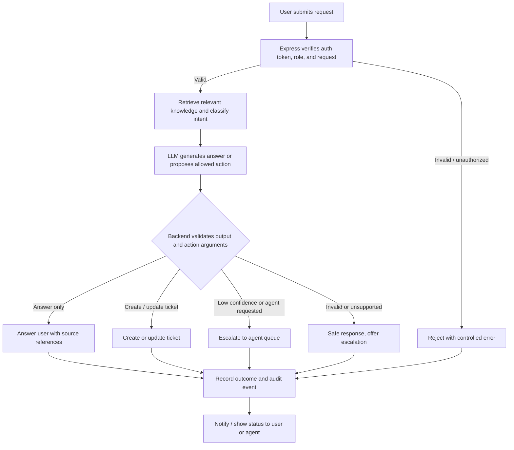

# 10. Workflow Automation

## Main Workflow

## Example Automation Cases

| Trigger                                     | Decision / Guardrail                                                        | Action                                                                | Fallback                                                                  |
| :------------------------------------------ | :-------------------------------------------------------------------------- | :-------------------------------------------------------------------- | :------------------------------------------------------------------------ |
| Question answered by approved documentation | Relevant context exists and no privileged action is required.               | Return answer with source reference.                                  | State uncertainty and offer escalation if context is insufficient.        |
| User asks to report a problem               | Required ticket fields are present or collected.                            | Create a ticket through the backend and return its ID.                | Ask for missing fields or show an error without claiming success.         |
| AI cannot resolve an issue                  | Low confidence, missing context, or user requests an agent.                 | Create or mark a ticket as escalated and place it in the agent queue. | Preserve the conversation summary for the agent.                          |
| External integration is requested           | Action is allowlisted, caller is authorized, and arguments pass validation. | Call configured test webhook or integration.                          | Log failure, avoid duplicate retries where possible, and inform the user. |

## Safety Notes

- Password resets and software provisioning are **simulated** unless the team obtains an explicitly authorized test integration.
- Any real privileged action must have server-side authorization and appropriate confirmation.
- The LLM may only _propose_ actions. The backend validates and executes them.

---

[← AI Prompt Design](09-ai-prompt-design.md) · [README](../../README.md) · Next: [Timeline](11-timeline.md)
