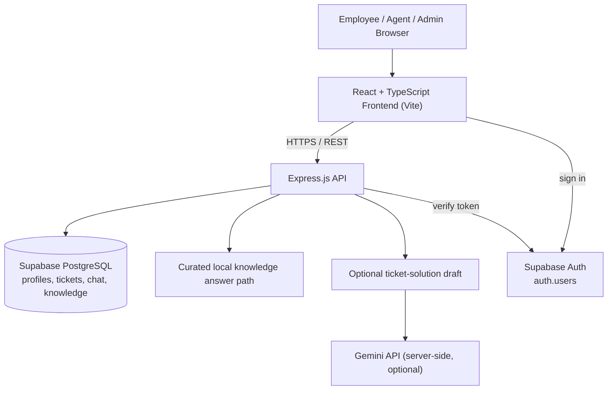
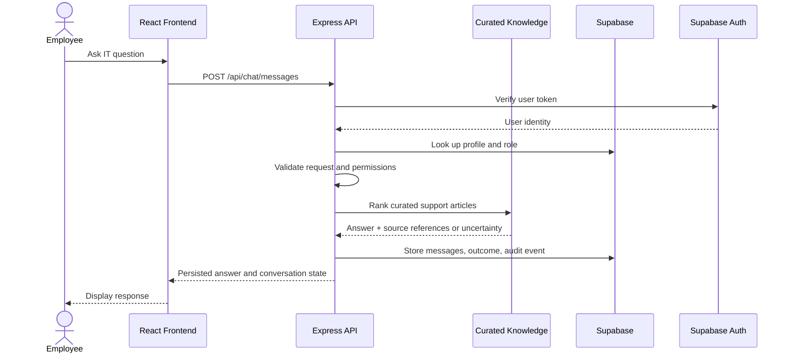

# 6. System Architecture

## High-Level Architecture

## Request Sequence

## Description

The frontend authenticates through Supabase Auth and sends its access token to the Express API. The API verifies the user and loads the trusted profile, including role and account status, before serving protected requests. Chat messages are answered against the curated local knowledge set and persisted with their source references. Ticket creation, assignment, replies, status changes, conversation management, and admin operations are validated and authorized by the API. Agents can request an optional Gemini-generated ticket-solution draft; the provider key remains server-side.

## Security Boundary

`GEMINI_API_KEY` and privileged database credentials remain server-side and are never sent to the browser. The language model has no direct database credentials or unrestricted access to external systems. Role checks and account-status enforcement happen on the server; the UI is not an authorization boundary.

---

[← Technologies](05-technologies.md) · [README](../../README.md) · Next: [Database Design](07-database-design.md)
