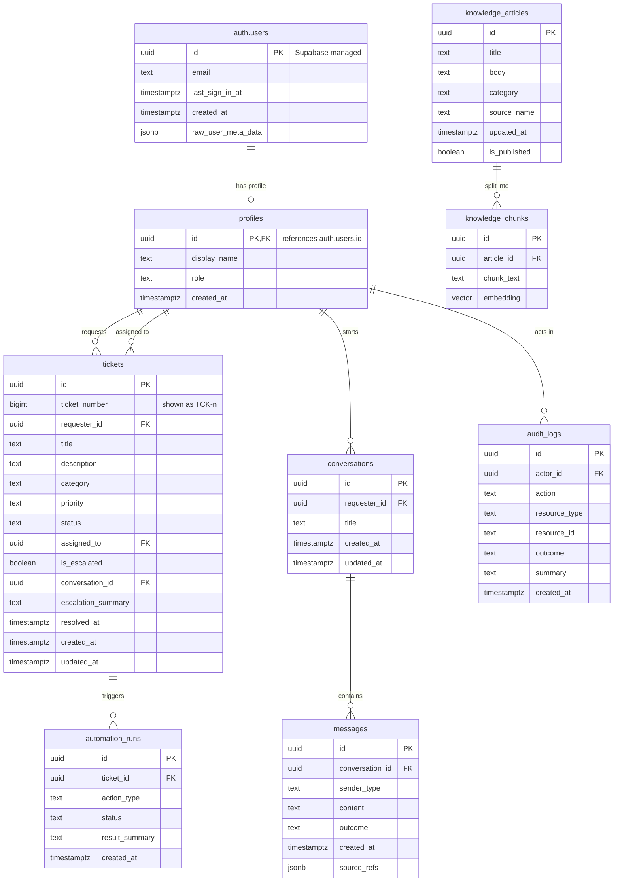

# 7. Database Design

> **Status:** Implemented in `supabase/migrations/` (core schema and RLS added in `20261105100000_helpdesk_core_schema.sql`).

The app uses Supabase Auth, which provides the built-in `auth.users` table. Our own `profiles` table links to it one-to-one and holds application data such as display name and role. All other tables reference `profiles`.

## Entity Relationship Diagram

## Table Alternative

### Entities

| Entity                            | Example Fields                                                                                                                                                                       | Purpose                                                                                |
| :-------------------------------- | :----------------------------------------------------------------------------------------------------------------------------------------------------------------------------------- | :------------------------------------------------------------------------------------- |
| `auth.users` _(Supabase managed)_ | id, email, last_sign_in_at, created_at, raw_user_meta_data                                                                                                                           | Built-in authentication table. Not edited directly by the app.                         |
| `profiles`                        | id (PK, FK → `auth.users.id`), display_name, role, created_at                                                                                                                        | Application profile and role mapping, linked one-to-one to `auth.users`.               |
| `tickets`                         | id, ticket_number, requester_id, title, description, category, priority, status, assigned_to, is_escalated, conversation_id, escalation_summary, resolved_at, created_at, updated_at | Tracks support requests and their lifecycle.                                           |
| `knowledge_articles`              | id, title, body, category, source_name, updated_at, is_published                                                                                                                     | Stores approved support procedures.                                                    |
| `knowledge_chunks`                | id, article_id, chunk_text, embedding                                                                                                                                                | Stores text chunks and vector embeddings for retrieval (pgvector).                     |
| `conversations`                   | id, requester_id, created_at                                                                                                                                                         | Groups chat sessions.                                                                  |
| `messages`                        | id, conversation_id, sender_type, content, created_at, source_refs                                                                                                                   | Stores chat messages and optional source references.                                   |
| `audit_logs`                      | id, actor_id, action, resource_type, resource_id, outcome, created_at                                                                                                                | Records significant actions and workflow outcomes without storing unnecessary secrets. |
| `automation_runs`                 | id, ticket_id, action_type, status, result_summary, created_at                                                                                                                       | Tracks safe workflow attempts and outcomes.                                            |

### Relationships

| Parent               | Child              | Cardinality | Notes                                                                |
| :------------------- | :----------------- | :---------- | :------------------------------------------------------------------- |
| `auth.users`         | `profiles`         | 1 : 0..1    | `profiles.id` is both primary key and foreign key to `auth.users.id` |
| `profiles`           | `tickets`          | 1 : many    | As requester and as assignee                                         |
| `profiles`           | `conversations`    | 1 : many    |                                                                      |
| `profiles`           | `audit_logs`       | 1 : many    | As actor, where applicable                                           |
| `conversations`      | `messages`         | 1 : many    |                                                                      |
| `knowledge_articles` | `knowledge_chunks` | 1 : many    |                                                                      |
| `tickets`            | `automation_runs`  | 1 : many    |                                                                      |

## Database Notes

- Supabase provides PostgreSQL and manages `auth.users`. Do not add app-specific columns to it; put them in `profiles`.
- `profiles.id` reuses the auth user's UUID. A profile row is typically created when a user signs up (for example, via a database trigger on `auth.users`). The exact mechanism is to be decided.
- `auth.users.raw_user_meta_data` can be edited by the user, so it must **not** be used to decide roles. The authoritative role lives in `profiles.role` and is changed only by admins or server-side code.
- Access policies (Row Level Security) must be configured on application tables.
- `knowledge_chunks.embedding` uses a `vector(N)` column where `N` must equal `EMBEDDING_DIMENSIONS` for the selected Gemini embedding model. Changing the embedding model or dimension requires re-embedding all chunks and a matching pgvector column size.
- Never expose a service-role key in the browser.
- Deleting an auth user should cascade or be handled for their profile, and the team should decide how tickets and audit logs are kept afterwards.

## Row Level Security

RLS is enabled on every application table. The Express API uses the service role and enforces authorization in code. The policies below limit what a browser session holding only the anon key and a user JWT can do directly.

| Table                                | Browser (authenticated) access                                                                        |
| :----------------------------------- | :---------------------------------------------------------------------------------------------------- |
| `profiles`                           | Read own row; agents/admins read all. No insert/update/delete, so users cannot change their own role. |
| `tickets`                            | Requesters read own; agents/admins read and update all; insert only as yourself with status `new`.    |
| `conversations`, `messages`          | Owner only. Users may insert only `user` messages into their own conversations.                       |
| `audit_logs`, `automation_runs`      | Admins read; writes are service-role only.                                                            |
| `knowledge_articles`                 | Read published articles.                                                                              |
| `knowledge_chunks`, `match_chunks()` | No browser access; service role only.                                                                 |

`public.current_app_role()` (security definer) reads `profiles.role` for `auth.uid()` and is used by the policies.

## Resolved Decisions

- Roles: `employee` (default), `agent`, `admin`.
- Profile creation: the `on_auth_user_created` trigger creates a profile with role `employee`. Only server-side code or SQL promotes roles.
- Retention: deleting a profile is blocked while it has requested tickets (`on delete restrict`). Assignee and audit-log actor references become null, so audit history is kept. Conversations cascade with their owner.
- `resolved_at` is set by trigger the first time a ticket reaches `resolved`/`closed`, and cleared if it is reopened.
- Embedding model and dimension: resolved as `gemini-embedding-001` with `EMBEDDING_DIMENSIONS=1536`; see [Gemini API Configuration](08-gemini-configuration.md).

---

[← System Architecture](06-system-architecture.md) · [README](../../README.md) · Next: [Gemini API Configuration](08-gemini-configuration.md)
