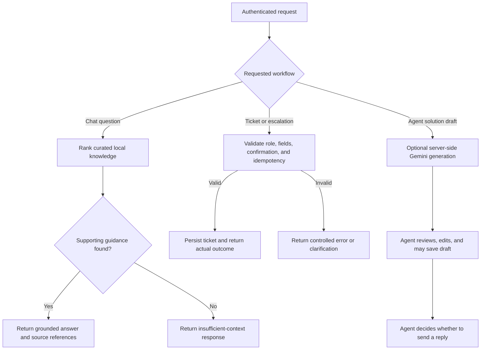

# 10. Workflow Automation

## Control objectives

- The backend verifies identity, role, ownership, and request fields before protected work.
- Chat answers use the curated local knowledge path; chat does not invoke an LLM or execute action proposals.
- Ticket creation, escalation, and simulated notifications use separate authenticated workflows. Action execution requires explicit confirmation and an idempotency key.
- Optional Gemini ticket-solution drafts remain agent-reviewed content. Generating or saving a draft does not send it to an employee.
- Invalid or unsupported requests fail safely and never report a write as successful before persistence.

## Implemented workflows

## Ticket and action controls

- Employees create and view their tickets through the ticket API. Escalation creates a ticket routed to the agent queue; it is not an LLM-generated chat action.
- `POST /api/actions/execute` accepts a caller-supplied proposal. The server validates its intent and arguments, checks role authorization, requires `X-Action-Confirmed` and `Idempotency-Key` for writes, and derives requester identity from the authenticated session.
- Test notifications are simulation-only, restricted to agents or admins, and disabled unless `ENABLE_TEST_NOTIFICATION_SIMULATION=true`.
- An agent may generate a ticket solution draft with Gemini, review/edit the content, and save the draft. A separate agent reply action is required to send a response.
- Knowledge-base submissions enter a review workflow; only authorized agents/admins can review and act on submissions.
- Account administration and ticket/chat access are role-scoped and enforced by the API, not by client-side role labels.

## Safe failure and audit

- Missing action fields return a clarification result; invalid payloads, roles, confirmations, or simulation settings are rejected.
- Ticket/action writes use idempotency keys where required so retries do not create an untracked duplicate operation.
- The API returns controlled errors when persistence or optional Gemini generation fails. No success ID or generated content is claimed on failure.
- Chat uncertainty is represented as an insufficient-context outcome with no fabricated source references.

## API contracts

See the [API specification pack](../api-specifications/README.md), especially the [chat contract](../api-specifications/chat-answer.md), [ticket contract](../api-specifications/tickets.md), and [allowlisted action contract](../api-specifications/allowlisted-actions.md). The prompt taxonomy is a future design reference, not the current workflow implementation.

---

[← AI Prompt Design](09-ai-prompt-design.md) · [Project README](../../../README.md) · Next: [Timeline](11-timeline.md)
